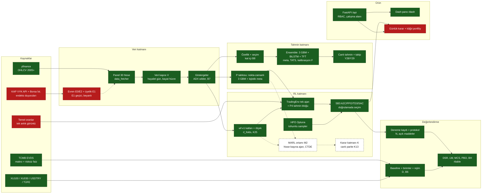
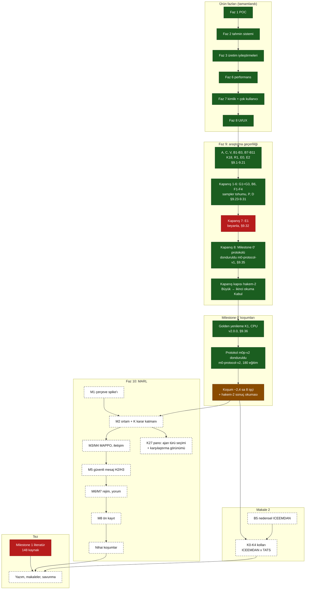

# Sistem akış haritası

**Son güncelleme:** 2026-11-15 · `v2.0.0` · Golden CPU'da yenilendi (K1), Faz 10 kararları K6/K9/K12/K15/K24, Milestone 0' **m0p-v2 donduruldu** (`m0-protocol-v2`, 180 eğitim, §9.36). Sırada koşum (PPO, sonra A2C).

Bu belge sistemin **canlı haritasıdır**: hangi bileşen var, veri nereden nereye akıyor, hangi aşama bitti, hangisi sürüyor, hangisi planlı. Diyagramlar Mermaid metni olduğu için GitHub'da çizilir ve PR'da fark olarak okunur.

## Nasıl güncellenir

Bir PR bir bileşenin ya da aşamanın **durumunu** değiştiriyorsa aynı PR bu belgeyi de günceller:
1. Diyagramdaki düğümün sınıfını değiştir (`:::done`, `:::active`, `:::planned`, `:::decision`, `:::partial`).
2. [Durum tablosundaki](#durum-tablosu) satırı güncelle (durum, kanıt, sıradaki).
3. Yukarıdaki "Son güncelleme" satırını sürüm ve tarihle güncelle.

Yeni bir bileşen ya da aşama eklerken üçünü birden yap: düğüm, ok ve tablo satırı. Ayrıntı buraya yazılmaz, bağlantı verilir: plan §9 alt bölümü, test, ölçüm JSON'u. Bu belge özet ve harita; tek gerçek kaynak plan belgeleridir.

**Renk anahtarı:**

| Sınıf | Anlamı |
|---|---|
| `done` (koyu yeşil) | Bitti, testli; kanıtı plan §9'da |
| `partial` (koyu kırmızı) | Var, ama bilinen açığı beyanlı (sınırlılık) |
| `active` (koyu kahverengi) | Şu an üzerinde çalışılıyor |
| `decision` (mor) | Kullanıcı kararı bekliyor |
| `planned` (beyaz, kesik çizgi) | Planlı, başlamadı |

---

## 1. Sistem mimarisi: veri akışı

**Okuma notları:**
- Kesik oklar henüz kurulmamış bağlantılar.
- **Tahmin RL'ye yalnız P tablosundan girer** (P4); canlı ensemble RL gözlemine bağlı değil.
- Temel oranlar ve E1 üyeliği `partial`: ilki nokta-zamanlı değil (`fundamentals_pit` açık), ikincisi geçici (§9.32).
- Günlük karar `partial`: canlı durum vektörü eğitim gözlemiyle tam eşleşmiyor (K13).

---

## 2. Geliştirme aşamaları

---

## Durum tablosu

| Aşama / bileşen | Durum | Kanıt | Sıradaki |
|---|---|---|---|
| Faz 1–3, 6–8 | bitti | [roadmap.md](roadmap.md) "Tamamlanan Fazlar" | — |
| Faz 9 A, C, V, B, K18, R1, E0, E2 | bitti | plan §9.1–9.21 | — |
| Faz 9 kapanış 1–6 (G, B6, F, sampler, P, D) | bitti | plan §9.23–9.31; İ1–İ3 uzman okumaları | — |
| Faz 9 kapanış 7: E1 tarihsel üyelik | beyanla kapandı | plan §9.32; `test_universe` 36 | Üretim KAP erişimi olursa 2013–2022 dönem içi olaylar |
| P4: P tablosu → eski RL ortamı | bitti | plan §9.32; `test_pit_table` 31 | — |
| Rota DTF + M8 son nokta test kaydı + koşum betiği | bitti | plan §9.33; `test_rl_walk_forward` 98 | — |
| Faz 9 kapanış 8: Milestone 0' protokolü | **donduruldu** (`m0-protocol-v1`) | [milestone0-protocol.md](milestone0-protocol.md); plan §9.33–9.35 | — (değişiklik = m0p-v2) |
| Golden yenileme (K1) | bitti (CPU; `v2.0.0`) | plan §9.36; `test_prediction_regression` yeşil | — (yeniden yenileme yalnız bilinçli davranış değişikliğinde) |
| Milestone 0' koşumları | sürüyor (m0p-v2 **donduruldu**, `m0-protocol-v2`; v1 koşulmadan bırakıldı) | [milestone0-protocol-v2.md](milestone0-protocol-v2.md); plan §9.36 | PPO 90 + A2C 90 eğitim (~2,4 sa, 8 işçi) → hakem-2 sonuç okuması |
| Makale 2 (B5 + K0–K4) | planlı | plan §4 "Makale 2 deney tasarımı", §9.14 | B5 nedensel ICEEMDAN, sonra kollar |
| Faz 10 M1 çerçeve spike'ı | planlı (K9 kararlı) | Faz 10 plan §4 S1, K9 | BenchMARL/TorchRL önce, ayrı `venv-marl/`; Windows, bütçe |
| Faz 10 M2–M8, nihai koşumlar | planlı | Faz 10 plan §3, §4 | M1'den sonra |
| K27 pano: ajan türü seçimi + karşılaştırma | planlı (karar 2026-11-15) | Faz 10 plan §6 K27 | M2 + karar katmanından (K1–K10) sonra |
| Canlı karar paritesi (K13) | açık | Faz 10 plan §6 | Karar katmanında |
| Y30 SHAP ucu, Y31 altın birimi | açık (ürün) | `prediction/CLAUDE.md` | Tez sonucu değil |
| Tez Milestone 1 (literatür) | kısmen | [roadmap.md](roadmap.md) Milestone 1 | Dört 2026 tam metni, YÖK taraması |
