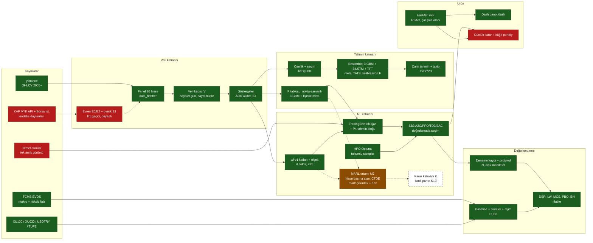
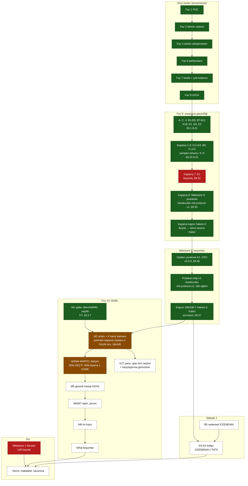

# Sistem akış haritası

**Son güncelleme:** 2026-11-19 · `v2.5.1` · Faz 10 M4b pilotu: PİLOT_İŞARETİ, mimari-eş kontrolde gat'ın iletişimi bilgi taşıyor işareti (G 0,26, z 3,05; [M4 tasarımı](phase-10-m4-design.md) §6.4). Önceki: M4a bitti, gat KISMİ, attn GÖZLENMEDİ (§3.7). Önceki: Faz 10 M4 tasarımı v0.1: `attn`/`gat` eşit bütçe, GAT grafı `sector + mst` önerisi, M4a komşu sinyali ön kaydı taslağı ([M4 tasarımı](phase-10-m4-design.md)). Önceki: Faz 10 M5 ön kaydı v0.1: P5c okuma kuralı sonuçtan önce yazıldı; gerçek sinyal kolları sağlamlık sorusu, mekanizma iddiaları yalnız pozitif kontrolde ([M5 tasarımı](phase-10-m5-design.md) §2). Önceki: Faz 10 M3b Aşama 1 (20 bps kapısı) koşuldu, etiket KISMİ: tohum sıralama koşulu sağlanmadı, ön kayıt gereği Aşama 2 koşulmadı ([M3 tasarımı](phase-10-m3-design.md) §6.7). Kullanıcı kararı: M4'e referans yapılandırmayla (MAPPO, tüm yerel gözlemler, α = 0,25; varsayılan, kanıta dayanmaz) geçilir (§6.8). Önceki (2026-11-18) Faz 10 M3a boru hattı kapısı koşuldu, etiket GEÇTİ (maliyetsiz, gelecekten türetilmiş pozitif kontrol; tez bulgusu değil); sırada M3b ön kaydı ([M3 tasarımı](phase-10-m3-design.md) §5.2). Önceki (2026-11-17) Faz 10 P5: `pit_v2` (hedef O_{t+1} → O_{t+2}) kuruldu, kapı `pit_v1` ile yan yana; ikisi de geçmiyor (0/30). `pit_v1` dondurulmuş, bit-eş. Önceki (2026-11-16) Faz 10 M2: `marl/` çekirdeği + PettingZoo ortamı; hakem-rl + hakem-finans Kabul; gerçek 30 sembollü panelde gözlem sağlığı ölçüldü, taban açılışta satış engeli (ön kayıtlı kural) uygulandı. S-obs ufuk hizası ölçüldü: PC060 yeni ortamda pozitif kontrol değil, M3 kontrolü PC060-K12 (§9.1). Hakem-2 kapanışı Küçük revizyon, işlendi; satış engeli dönem bağımlı fiyat marjı (v0.7). M2 çekirdeği kapandı, sırada M3 ([M2 tasarımı](phase-10-m2-design.md) §9).

Bu belge sistemin **canlı haritasıdır**: hangi bileşen var, veri nereden nereye akıyor, hangi aşama bitti, hangisi sürüyor, hangisi planlı. Diyagramlar Mermaid metni olduğu için GitHub'da çizilir ve PR'da fark olarak okunur.

## Nasıl güncellenir

Bir PR bir bileşenin ya da aşamanın **durumunu** değiştiriyorsa aynı PR bu belgeyi de günceller:
1. Diyagramdaki düğümün sınıfını değiştir (`:::done`, `:::active`, `:::planned`, `:::decision`, `:::partial`).
2. [Durum tablosundaki](#durum-tablosu) satırı güncelle (durum, kanıt, sıradaki).
3. Yukarıdaki "Son güncelleme" satırını sürüm ve tarihle güncelle.

Yeni bir bileşen ya da aşama eklerken üçünü birden yap: düğüm, ok ve tablo satırı. Ayrıntı buraya yazılmaz, bağlantı verilir: plan §9 alt bölümü, test, ölçüm JSON'u. Bu belge özet ve harita; tek gerçek kaynak plan belgeleridir.

**Renk anahtarı:**

| Sınıf | Anlamı |
|---|---|
| `done` (koyu yeşil) | Bitti, testli; kanıtı plan §9'da |
| `partial` (koyu kırmızı) | Var, ama bilinen açığı beyanlı (sınırlılık) |
| `active` (koyu kahverengi) | Şu an üzerinde çalışılıyor |
| `decision` (mor) | Kullanıcı kararı bekliyor |
| `planned` (beyaz, kesik çizgi) | Planlı, başlamadı |

---

## 1. Sistem mimarisi: veri akışı

**Okuma notları:**
- Kesik oklar henüz kurulmamış bağlantılar.
- **Tahmin RL'ye yalnız P tablosundan girer** (P4); canlı ensemble RL gözlemine bağlı değil.
- Temel oranlar ve E1 üyeliği `partial`: ilki nokta-zamanlı değil (`fundamentals_pit` açık), ikincisi geçici (§9.32).
- Günlük karar `partial`: canlı durum vektörü eğitim gözlemiyle tam eşleşmiyor (K13).

---

## 2. Geliştirme aşamaları

---

## Durum tablosu

| Aşama / bileşen | Durum | Kanıt | Sıradaki |
|---|---|---|---|
| Faz 1–3, 6–8 | bitti | [roadmap.md](roadmap.md) "Tamamlanan Fazlar" | — |
| Faz 9 A, C, V, B, K18, R1, E0, E2 | bitti | plan §9.1–9.21 | — |
| Faz 9 kapanış 1–6 (G, B6, F, sampler, P, D) | bitti | plan §9.23–9.31; İ1–İ3 uzman okumaları | — |
| Faz 9 kapanış 7: E1 tarihsel üyelik | beyanla kapandı | plan §9.32; `test_universe` 36 | Üretim KAP erişimi olursa 2013–2022 dönem içi olaylar |
| P4: P tablosu → eski RL ortamı | bitti | plan §9.32; `test_pit_table` 31 | — |
| Rota DTF + M8 son nokta test kaydı + koşum betiği | bitti | plan §9.33; `test_rl_walk_forward` 98 | — |
| Faz 9 kapanış 8: Milestone 0' protokolü | **donduruldu** (`m0-protocol-v1`) | [milestone0-protocol.md](milestone0-protocol.md); plan §9.33–9.35 | — (değişiklik = m0p-v2) |
| Golden yenileme (K1) | bitti (CPU; `v2.0.0`) | plan §9.36; `test_prediction_regression` yeşil | — (yeniden yenileme yalnız bilinçli davranış değişikliğinde) |
| Milestone 0' koşumları | **bitti, ara karar** (180/180; Q2 boş, PC060 boş). Pozitif kontrol ölçümleri: (a) RL'siz değer MDE'yi aşıyor, (b) politika bloktan değer üretmiyor | plan §9.37–9.39; `measurements/phase10-m0/` | İleri veri; S-obs girdisi Faz 10 §3.2.7 |
| Makale 2 (B5 + K0–K4) | planlı | plan §4 "Makale 2 deney tasarımı", §9.14 | B5 nedensel ICEEMDAN, sonra kollar |
| Faz 10 M1 çerçeve spike'ı | **bitti**: BenchMARL + TorchRL seçildi (K9, 2026-11-16) | Faz 10 plan §3.2.7; `measurements/phase10-m1/` | M2 ortam (spike girdileri: nakit üst sınırı, eksik hücre maskesi, M4 parametre eşitliği) |
| Faz 10 M2 ortam + karar çekirdeği | **sürüyor**: `marl/` (muhasebe, projeksiyon, K5, `obs_spec` v1, K2) + PettingZoo ortamı; logit sınırı 5 + ln N; hakem-rl + hakem-finans Kabul; gerçek panel ölçüldü; taban açılışta satış engeli | [phase-10-m2-design.md](phase-10-m2-design.md); `test_marl_core` 61, `test_marl_env` 36; `measurements/phase10-m2/obs_health.json` | M3: BenchMARL görevi + PC060-K12 P tablosu; 2021+ öncesi fiyat marjı geçmişi doğrulaması (tasarım §2.5, §9) |
| Faz 10 P5: tahmin hedefi K12 yürütme ufkuna (`pit_v2`) | **bitti**: `target='open_to_open'`, purge h+1, bant dışı açılış maskesi; `pit_v1` bit-eş. Kapı: 0/30 bilgili (`pit_v1` gibi); havuzlu AUC 0,5044 | Faz 10 plan §3.1.3 "P5 durumu"; `test_pit_table` 45; `measurements/phase10-p5/` | M5 ön kaydı §2'de okuma kuralı yazıldı ([phase-10-m5-design.md](phase-10-m5-design.md), v0.1) |
| Faz 10 M3a boru hattı kapısı | **bitti, GEÇTİ**: A1 (PC060-K12) ↔ S1 (karıştırılmış), 3 tohum, maliyetsiz, 600 bin kare. Tez bulgusu değil | [phase-10-m3-design.md](phase-10-m3-design.md) §5.2; `test_marl_m3` 18; `measurements/phase10-m3/m3a_results.json` | — |
| Faz 10 M3b 20 bps kapısı | **Aşama 1 bitti, KISMİ**: A1c ↔ S1c, 3 tohum, 600 bin kare; sıralama koşulu sağlanmadı, Aşama 2 koşulmadı. Tez bulgusu değil | [phase-10-m3-design.md](phase-10-m3-design.md) §6.7; `measurements/phase10-m3/m3b_stage1.json` | M4 temeli referans yapılandırma (kullanıcı kararı 2026-11-19, §6.8) |
| Sistem rehberi ve sözlük (K28) | **planlı, onay bekliyor**: tek kaynak `dashboard/content/`, pano "Rehber" sayfası, R1–R4 | [system-guide-plan.md](system-guide-plan.md) | Kullanıcı onayı, sonra R1 (sözlük çekirdeği ~60 terim) |
| Faz 10 M4–M8, nihai koşumlar | planlı; M4 temeli referans yapılandırma; M4 tasarımı v0.1 (`attn`/`gat` kodlu, `test_marl_m4` 14, koşu yok); M5 ön kaydı v0.2 (yalnız §2 P5c okuma kuralı + kararlar) | Faz 10 plan §3, §4; [phase-10-m3-design.md](phase-10-m3-design.md) §6.8; [phase-10-m5-design.md](phase-10-m5-design.md) | M4a bitti (gat KISMİ, attn GÖZLENMEDİ); M4b pilotu PİLOT_İŞARETİ (§6.4); M5 mekanizma tabanı kullanıcı kararı ([phase-10-m4-design.md](phase-10-m4-design.md)) |
| K27 pano: ajan türü seçimi + karşılaştırma | planlı (karar 2026-11-15) | Faz 10 plan §6 K27 | M2 + karar katmanından (K1–K10) sonra |
| Canlı karar paritesi (K13) | açık | Faz 10 plan §6 | Karar katmanında |
| Y30 SHAP ucu, Y31 altın birimi | açık (ürün) | `prediction/CLAUDE.md` | Tez sonucu değil |
| Tez Milestone 1 (literatür) | kısmen | [roadmap.md](roadmap.md) Milestone 1 | Dört 2026 tam metni, YÖK taraması |
