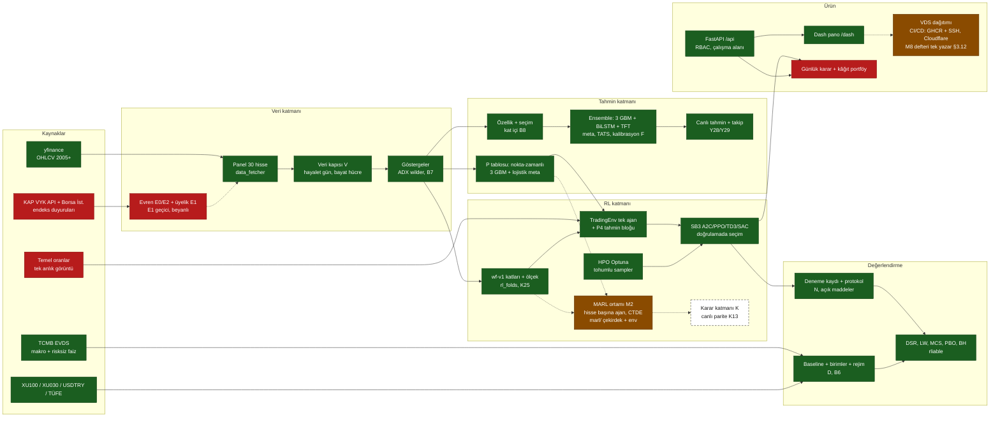
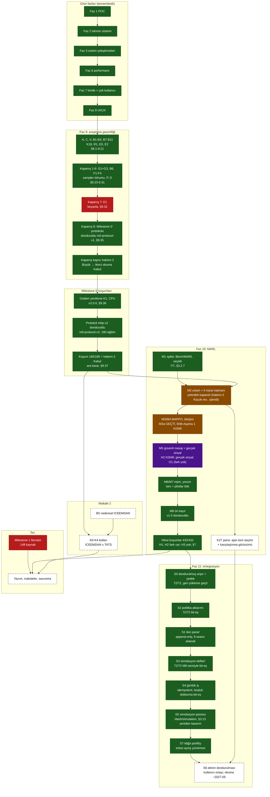

# Sistem akış haritası

**Son güncelleme:** 2026-11-25 · `v2.28.0` · Arayüz metinleri ve kullanılabilirlik: eski sayfalar Türkçe karakterle, ortak Türkçe biçim (para, saat TRT), veri dosya listesi sayfalı tablo, boş durumlar, tek ajanlı sayfalara kapsam notu ([phase-11-integration-plan.md](phase-11-integration-plan.md) §3.15). Önceki: 2026-11-25 · `v2.27.0` · Ana sayfa güncel duruma: M8 nihai testinin özeti (öğrenen kolların en yükseği kural portföylerinin yanında; sıralama değil), simülasyon kutusu ve durum şeridi; rehberde M8 kartları ([phase-11-integration-plan.md](phase-11-integration-plan.md) §3.14). Önceki: 2026-11-25 · `v2.26.0` · Simülasyon sayfası yeniden tasarımı: eldeki hisseler (ort. maliyet, gün/toplam K/Z), gün özeti (katkı + emirler), gün seçimi, dağılım ve tohum grafiği; günlük defter `forward_views.daily_book` ([phase-11-integration-plan.md](phase-11-integration-plan.md) §3.13). Önceki: 2026-11-25 · `v2.25.0` · M8 ileri veri deposunun VDS'ye devri: tek yazar bekçisi, devir paritesi betiği, imajda günlük iş ([phase-11-integration-plan.md](phase-11-integration-plan.md) §3.12). Önceki: 2026-11-24 · `v2.24.0` · Sunucu dağıtımı: GitHub Actions CI (imaj + sağlık) ve sürüm etiketiyle GHCR → VDS dağıtımı, sağlıksız sürümde geri dönüş ([ci-cd.md](../deployment/ci-cd.md)); M8 defteri yerelde. Önceki: 2026-11-22 · `v2.22.0` · Faz 11 S7 bitti: kâğıt portföy ertesi açılış yürütmesi + canlı gözlem uyarıları ([phase-11-integration-plan.md](phase-11-integration-plan.md) §3.8). Önceki: 2026-11-22 · `v2.21.0` · Faz 11 S5 bitti: simülasyon panosu `/dash/simulation` ([phase-11-integration-plan.md](phase-11-integration-plan.md) §3.7). Önceki: 2026-11-22 · `v2.20.0` · Faz 11 S6 ileri veri ön kayıt eki v0.3 (hakem Kabul) + okuma betiği; dondurma kullanıcı onayı bekliyor ([phase-11-integration-plan.md](phase-11-integration-plan.md) §3.6). Önceki: 2026-11-22 · `v2.19.0` · Faz 11 S4 bitti: günlük iş (panel → karar → defter) idempotent, boşluk doldurma bit-eş, marj kapsamı düzeneği ([phase-11-integration-plan.md](phase-11-integration-plan.md) §3.5). Önceki: 2026-11-22 · `v2.18.0` · Faz 11 S3 bitti: simülasyon defteri 2026 test penceresinde 72/72 politika M8 serisiyle bit-eş ([phase-11-integration-plan.md](phase-11-integration-plan.md) §3.4); sırada S6 ön kayıt eki. Önceki: 2026-11-22 · `v2.17.0` · Faz 11 S1 bitti: M8 ileri paneli append-only, önceki satırlar bit-eş, 9 gerçek seans eklendi ([phase-11-integration-plan.md](phase-11-integration-plan.md) §3.3); sırada S3 simülasyon defteri. Önceki: 2026-11-22 · `v2.16.0` · Faz 11 S2 bitti: dondurulmuş M8 politikalarının sade ileri geçişi ana venv'de, 72/72 bit-eş; referans seri M8 test kaydıyla aynı ([phase-11-integration-plan.md](phase-11-integration-plan.md) §3.2); sırada S1 ileri panel. Önceki: 2026-11-22 · `v2.15.0` · Faz 11 S0 bitti: dondurulmuş M8 politika arşivi (72/72 doğrulandı), harici disk yedeği ve geri yükleme denemesi ([phase-11-integration-plan.md](phase-11-integration-plan.md) §3.1); sırada S2 politika aktarımı. Önceki: 2026-11-22 · `v2.14.0` · Faz 10 M8 nihai koşumlar bitti ve okundu ([phase-10-m8-design.md](phase-10-m8-design.md) §7): 432/432, denetimler tamam; H1 FARK_VAR_MARL (yila_bagli, secime_dayanikli; 6 yılda ortalama), H2 FARK_VAR_M-none (katlar_tutarli, secime_dayanikli; 6 yılda ortalama), H3 ve negatif kontrol FARK_GOZLENMEDI; betimsel: H2'nin farkı maliyet sürüklemesiyle açıklanıyor, H1'in yaklaşık yarısı maliyetten bağımsız; kural portföyleri 20 bps'de öğrenen kolların üstünde. Faz 10 araştırma kapanışı TAMAM: hakem-2 Büyük revizyon (yalnız metin) işlendi, ikinci okuma Kabul (plan §9); vision v0.3.1 G1 daraltıldı; Faz 11 entegrasyon planı v0.1 taslak ([phase-11-integration-plan.md](phase-11-integration-plan.md)). Önceki: 2026-11-21 · Faz 10 M8 ön kaydı v1.0 DONDURULDU ([phase-10-m8-design.md](phase-10-m8-design.md) §6): H1 MAPPO ↔ SARL-eşmimari, H2/H3 Holm, boş kol negatif kontrol; 6 kol × 12 tohum × 6 kat = 432 koşu, yıl yıl partiler ve sağlık kaydı; A4 (min-var/HRP baseline, `analyze_m8.py`) bitti. Sırada 2021 katı. Önceki: 2026-11-21 · Faz 10 M8 tasarımı v0.3 TASLAK ([phase-10-m8-design.md](phase-10-m8-design.md)): A1 kat koşucusu (eşit aralıklı kontrol noktası, doğrulamada `rl_folds` kuralıyla seçim, test bir kez) ve A2 SARL kolları (`marl/sarl.py`; eşmimari = MARL ajan MLP'si) bitti; K-M8-1: çıkarım tohum × kat düzeyinde. Sırada gürültü tabanı. Önceki: 2026-11-20 · M8 tasarımı v0.1: eksik altyapı belirlendi, gürültü tabanı tasarlandı, karar bekleyen maddeler K-M8-1..6. Koşu yok. Önceki: `v2.13.0` · Faz 10 M8 engel 1a: fiyat marjı 2021+ kaynakla doğrulandı. Borsa İstanbul 2020/20 sayılı duyurunun %10'u hâlâ yürürlükte; takvime yeni giriş yok, doğrulanmış kapsam 2026-11-09 ([M2 tasarımı](phase-10-m2-design.md) §2.5, `measurements/phase10-m8/price_limit_audit.json`). Panel kaynağı İş Yatırım ile denetlendi ve M8 paneli `m8-v1` düzeltmesiyle kuruldu: kesik gün çubukları yamandı, SKBNK'nin yanlış günden düzeltilmiş iki bedelli artırımı çarpanla düzeltildi, 2023-02-08 iptal seansı atıldı; 2021+ bant dışı kapanış 38 → 0 ([M2 tasarımı](phase-10-m2-design.md) §6.1). Önceki: `v2.12.0` · Faz 10 §3.2.8 ortam hızı: toplu yerel ortam (`marl/batched_env.py`, parite bit-eş), tek koşu 1,55×, üç eş zamanlı koşuyla saatte 3,4× koşu; M3a pozitif kontrolü bu toplayıcıyla tekrarlandı, GEÇTİ ([M3 tasarımı](phase-10-m3-design.md) §5.4). M8'in ortam hızı engeli kalktı. Önceki: `v2.11.0` · Faz 10 M6b S-reg pilotu FARK_YOK, M7b dikkat testleri (betimsel), HMM eşlemesi `calm_vs_rest` ([M6 tasarımı](phase-10-m6-design.md) §3.3, §6.1). Önceki: Faz 10 M6/M7: tasarım v0.5, M6a HMM, M6c okuma aracı, M7a maskeleme bitti; M6b pilot ön kayıtlı ([M6 tasarımı](phase-10-m6-design.md)). Önceki: `v2.10.0` · Faz 10 M5 gerçek sinyal kolları koşuldu: SO ve SB yollarında `O1_fark_yok` (bu sinyal ve bu güçle fark tespit edilmedi; [M5 tasarımı](phase-10-m5-design.md) §5.10). Önceki: `v2.9.0` · K28 R4 bitti: sözlük 171 terim (8 kategori; yazılım ve ürün eklendi), üst çubuk aramasında sözlük terimleri ([rehber planı](system-guide-plan.md) §15). Önceki: 2026-11-19 · `v2.8.0` · Faz 10 M5 mekanizma kolları: H2 KISMİ (`gurultu_tabani`), H3 SINANMADI ([M5 tasarımı](phase-10-m5-design.md) §4.11). Önceki: K28 R3: Rehber'e aşama çizelgesi ve deney kartları (kaynaklı sayılar, `snapshot.json`); M2 satırı "bitti" olarak düzeltildi. Önceki: K28 R2: panoda "Rehber" sayfası (`/dash/guide`). Önceki: K28 R1: sistem sözlüğü (73 terim, sade + teknik) [`docs/sozluk.md`](../sozluk.md), tek kaynak `dashboard/content/glossary.yaml`. Önceki: `v2.6.0` · K28 rehber + sözlük planı onaylandı. Faz 10 M4b pilotu: PİLOT_İŞARETİ, mimari-eş kontrolde gat'ın iletişimi bilgi taşıyor işareti (G 0,26, z 3,05; [M4 tasarımı](phase-10-m4-design.md) §6.4). Önceki: M4a bitti, gat KISMİ, attn GÖZLENMEDİ (§3.7). Önceki: Faz 10 M4 tasarımı v0.1: `attn`/`gat` eşit bütçe, GAT grafı `sector + mst` önerisi, M4a komşu sinyali ön kaydı taslağı ([M4 tasarımı](phase-10-m4-design.md)). Önceki: Faz 10 M5 ön kaydı v0.1: P5c okuma kuralı sonuçtan önce yazıldı; gerçek sinyal kolları sağlamlık sorusu, mekanizma iddiaları yalnız pozitif kontrolde ([M5 tasarımı](phase-10-m5-design.md) §2). Önceki: Faz 10 M3b Aşama 1 (20 bps kapısı) koşuldu, etiket KISMİ: tohum sıralama koşulu sağlanmadı, ön kayıt gereği Aşama 2 koşulmadı ([M3 tasarımı](phase-10-m3-design.md) §6.7). Kullanıcı kararı: M4'e referans yapılandırmayla (MAPPO, tüm yerel gözlemler, α = 0,25; varsayılan, kanıta dayanmaz) geçilir (§6.8). Önceki (2026-11-18) Faz 10 M3a boru hattı kapısı koşuldu, etiket GEÇTİ (maliyetsiz, gelecekten türetilmiş pozitif kontrol; tez bulgusu değil); sırada M3b ön kaydı ([M3 tasarımı](phase-10-m3-design.md) §5.2). Önceki (2026-11-17) Faz 10 P5: `pit_v2` (hedef O_{t+1} → O_{t+2}) kuruldu, kapı `pit_v1` ile yan yana; ikisi de geçmiyor (0/30). `pit_v1` dondurulmuş, bit-eş. Önceki (2026-11-16) Faz 10 M2: `marl/` çekirdeği + PettingZoo ortamı; hakem-rl + hakem-finans Kabul; gerçek 30 sembollü panelde gözlem sağlığı ölçüldü, taban açılışta satış engeli (ön kayıtlı kural) uygulandı. S-obs ufuk hizası ölçüldü: PC060 yeni ortamda pozitif kontrol değil, M3 kontrolü PC060-K12 (§9.1). Hakem-2 kapanışı Küçük revizyon, işlendi; satış engeli dönem bağımlı fiyat marjı (v0.7). M2 çekirdeği kapandı, sırada M3 ([M2 tasarımı](phase-10-m2-design.md) §9).

Bu belge sistemin **canlı haritasıdır**: hangi bileşen var, veri nereden nereye akıyor, hangi aşama bitti, hangisi sürüyor, hangisi planlı. Diyagramlar Mermaid metni olduğu için GitHub'da çizilir ve PR'da fark olarak okunur.

## Nasıl güncellenir

Bir PR bir bileşenin ya da aşamanın **durumunu** değiştiriyorsa aynı PR bu belgeyi de günceller:
1. Diyagramdaki düğümün sınıfını değiştir (`:::done`, `:::active`, `:::planned`, `:::decision`, `:::partial`).
2. [Durum tablosundaki](#durum-tablosu) satırı güncelle (durum, kanıt, sıradaki).
3. Yukarıdaki "Son güncelleme" satırını sürüm ve tarihle güncelle.

Yeni bir bileşen ya da aşama eklerken üçünü birden yap: düğüm, ok ve tablo satırı. Ayrıntı buraya yazılmaz, bağlantı verilir: plan §9 alt bölümü, test, ölçüm JSON'u. Bu belge özet ve harita; tek gerçek kaynak plan belgeleridir.

**Renk anahtarı:**

| Sınıf | Anlamı |
|---|---|
| `done` (koyu yeşil) | Bitti, testli; kanıtı plan §9'da |
| `partial` (koyu kırmızı) | Var, ama bilinen açığı beyanlı (sınırlılık) |
| `active` (koyu kahverengi) | Şu an üzerinde çalışılıyor |
| `decision` (mor) | Kullanıcı kararı bekliyor |
| `planned` (beyaz, kesik çizgi) | Planlı, başlamadı |

---

## 1. Sistem mimarisi: veri akışı

**Okuma notları:**
- Kesik oklar henüz kurulmamış bağlantılar.
- **Tahmin RL'ye yalnız P tablosundan girer** (P4); canlı ensemble RL gözlemine bağlı değil.
- Temel oranlar ve E1 üyeliği `partial`: ilki nokta-zamanlı değil (`fundamentals_pit` açık), ikincisi geçici (§9.32).
- Günlük karar `partial`: canlı durum vektörü eğitim gözlemiyle tam eşleşmiyor (K13).

---

## 2. Geliştirme aşamaları

---

## Durum tablosu

| Aşama / bileşen | Durum | Kanıt | Sıradaki |
|---|---|---|---|
| Faz 1–3, 6–8 | bitti | [roadmap.md](roadmap.md) "Tamamlanan Fazlar" | — |
| Faz 9 A, C, V, B, K18, R1, E0, E2 | bitti | plan §9.1–9.21 | — |
| Faz 9 kapanış 1–6 (G, B6, F, sampler, P, D) | bitti | plan §9.23–9.31; İ1–İ3 uzman okumaları | — |
| Faz 9 kapanış 7: E1 tarihsel üyelik | beyanla kapandı | plan §9.32; `test_universe` 36 | Üretim KAP erişimi olursa 2013–2022 dönem içi olaylar |
| P4: P tablosu → eski RL ortamı | bitti | plan §9.32; `test_pit_table` 31 | — |
| Rota DTF + M8 son nokta test kaydı + koşum betiği | bitti | plan §9.33; `test_rl_walk_forward` 98 | — |
| Faz 9 kapanış 8: Milestone 0' protokolü | **donduruldu** (`m0-protocol-v1`) | [milestone0-protocol.md](milestone0-protocol.md); plan §9.33–9.35 | — (değişiklik = m0p-v2) |
| Golden yenileme (K1) | bitti (CPU; `v2.0.0`) | plan §9.36; `test_prediction_regression` yeşil | — (yeniden yenileme yalnız bilinçli davranış değişikliğinde) |
| Milestone 0' koşumları | **bitti, ara karar** (180/180; Q2 boş, PC060 boş). Pozitif kontrol ölçümleri: (a) RL'siz değer MDE'yi aşıyor, (b) politika bloktan değer üretmiyor | plan §9.37–9.39; `measurements/phase10-m0/` | İleri veri; S-obs girdisi Faz 10 §3.2.7 |
| Makale 2 (B5 + K0–K4) | planlı | plan §4 "Makale 2 deney tasarımı", §9.14 | B5 nedensel ICEEMDAN, sonra kollar |
| Faz 10 M1 çerçeve spike'ı | **bitti**: BenchMARL + TorchRL seçildi (K9, 2026-11-16) | Faz 10 plan §3.2.7; `measurements/phase10-m1/` | M2 ortam (spike girdileri: nakit üst sınırı, eksik hücre maskesi, M4 parametre eşitliği) |
| Faz 10 M2 ortam + karar çekirdeği | **bitti** (2026-11-16; hakem-rl + hakem-finans Kabul; hakem-2 kapanış ikinci okuma Kabul, [review-panel.md](review-panel.md)): `marl/` (muhasebe, projeksiyon, K5, `obs_spec` v1, K2) + PettingZoo ortamı; logit sınırı 5 + ln N; hakem-rl + hakem-finans Kabul; gerçek panel ölçüldü; taban açılışta satış engeli | [phase-10-m2-design.md](phase-10-m2-design.md); `test_marl_core` 61, `test_marl_env` 36; `measurements/phase10-m2/obs_health.json` | M3: BenchMARL görevi + PC060-K12 P tablosu; 2021+ öncesi fiyat marjı geçmişi doğrulaması (tasarım §2.5, §9) |
| Faz 10 P5: tahmin hedefi K12 yürütme ufkuna (`pit_v2`) | **bitti**: `target='open_to_open'`, purge h+1, bant dışı açılış maskesi; `pit_v1` bit-eş. Kapı: 0/30 bilgili (`pit_v1` gibi); havuzlu AUC 0,5044 | Faz 10 plan §3.1.3 "P5 durumu"; `test_pit_table` 45; `measurements/phase10-p5/` | M5 ön kaydı §2'de okuma kuralı yazıldı ([phase-10-m5-design.md](phase-10-m5-design.md), v0.1) |
| Faz 10 M3a boru hattı kapısı | **bitti, GEÇTİ**: A1 (PC060-K12) ↔ S1 (karıştırılmış), 3 tohum, maliyetsiz, 600 bin kare. Tez bulgusu değil | [phase-10-m3-design.md](phase-10-m3-design.md) §5.2; `test_marl_m3` 18; `measurements/phase10-m3/m3a_results.json` | — |
| Faz 10 M3b 20 bps kapısı | **Aşama 1 bitti, KISMİ**: A1c ↔ S1c, 3 tohum, 600 bin kare; sıralama koşulu sağlanmadı, Aşama 2 koşulmadı. Tez bulgusu değil | [phase-10-m3-design.md](phase-10-m3-design.md) §6.7; `measurements/phase10-m3/m3b_stage1.json` | M4 temeli referans yapılandırma (kullanıcı kararı 2026-11-19, §6.8) |
| Sistem rehberi ve sözlük (K28) | **R1–R4 bitti (2026-11-20)**: sözlük 171 terim, 8 kategori, üst çubuk aramasında terimler (`dashboard/content/glossary.yaml` → [`docs/sozluk.md`](../sozluk.md)); pano `/dash/guide` "Rehber" sayfası (anlatım, akış, aşama çizelgesi, 5 deney kartı, sınırlar, sözlük araması; `snapshot.json`); `tests/test_guide.py` 9/9 | [system-guide-plan.md](system-guide-plan.md) | Görsel denetim + konteyner (R4 araması ve yeni terimler) |
| Faz 10 M4 iletişim kapıları | **bitti**: M4a gat KISMİ, attn GÖZLENMEDİ; M4b pilotu PİLOT_İŞARETİ (gat ↔ mimari-eş `self`). Tez bulgusu değil | [phase-10-m4-design.md](phase-10-m4-design.md) §3.7, §6.4; `measurements/phase10-m4/` | — (taban gat: kullanıcı kararı) |
| Faz 10 M5 tahmin sinyali + güvenle ağırlıklı iletişim | **bitti (pilot), karar kullanıcıda**: mekanizma kolları (sentetik) H2 KISMİ (gürültü tabanı aşılmadı), H3 SINANMADI; gerçek sinyal kolları (pit_v2, 20 bps, 24 koşu) gözlem ve gözlem + mesaj yollarında `O1_fark_yok`. Tez bulgusu değil | [phase-10-m5-design.md](phase-10-m5-design.md) §4.11, §5.10; `measurements/phase10-m5/m5_results.json`, `m5real_results.json`; `test_marl_m5_msg` 20 | Kullanıcı kararı: M6/M7'ye geçiş ya da daha bilgili sinyalle yeni ön kayıt; M8 öncesi ortam hızı (§3.2.8) |
| Faz 10 M6/M7 rejim ve yorumlanabilirlik | **bitti (tanı ve pilotlar)**: tasarım v0.8; K-M6-1..5 kapandı (HMM iki hücre `calm_vs_rest`). M6a HMM ikinci tanım, M6c rejime koşullu okuma aracı, M7a mesaj maskeleme; **M6b S-reg pilotu FARK_YOK** (öğrenme bozulmuyor; S-reg ana tasarımda); **M7b dikkat testleri**: dikkat neredeyse tek biçimli, karıştırılmış mesaj M7a'nın dağılım dışı payını ayırıyor (betimsel) | [phase-10-m6-design.md](phase-10-m6-design.md) §2–§6.1; `measurements/phase10-m6/`, `phase10-m7/` | M8 ön kaydı (engeller satır altında) |
| Faz 10 M8, nihai koşumlar | **bitti, okundu (2026-11-22)**: 432/432 koşu, denetimler tamam (tek commit, temiz ağaç, eksik/tanımsız 0). H1 M-none ↔ S-esm FARK_VAR_MARL (yila_bagli, secime_dayanikli; 6 yılda ortalama; Δ̄ +0,47), H2 M-none ↔ S-agr FARK_VAR_M-none (katlar_tutarli, secime_dayanikli; 6 yılda ortalama; +0,28), H3 gat ↔ self FARK_GOZLENMEDI (yila_bagli, secime_duyarli; 6 yılda ortalama), negatif kontrol FARK_GOZLENMEDI. Betimsel: H2'nin farkı maliyet sürüklemesiyle açıklanıyor (0 bps'de tohum kümeli GA [−0,14, 0,13]), H1'in yaklaşık yarısı maliyetten bağımsız; eşler 12 tohum kümesi, H1/H2 kümeli testte sağlam (§7.5); kural portföyleri (1/N 0,54, min-var/HRP 0,61) 20 bps'de öğrenen kolların hepsinin üstünde (en iyi M-none 0,31). Hakem-2 Büyük revizyon (yalnız metin) işlendi, ikinci okuma Kabul; Faz 10 araştırma kapanışı tamam | [M8 tasarımı](phase-10-m8-design.md) §6 (ön kayıt), §7 (okuma); `measurements/phase10-m8/m8_reading.json`, `m8_robustness.json`, `status/`; `test_marl_baselines` 7, `analyze_m8 --self-test` 11 | İleri veri okuması (2026-11-23'ten itibaren ≥ 126 seans, §6.7) |
| K27 pano: ajan türü seçimi + karşılaştırma | planlı (karar 2026-11-15) | Faz 10 plan §6 K27 | M2 + karar katmanından (K1–K10) sonra |
| Faz 11 entegrasyon + sanal para simülasyonu | **plan v0.9; S0–S5 ve S7 bitti (2026-11-22); S6 eki dondurma onayı bekliyor**: S7 "Uygula" ertesi açılışta (`/trading/apply-decision`, K-F11-5) + canlı gözlem uyarıları (K13; `test_paper_execution` 4). S5 pano `/dash/simulation` (`dashboard/pages/simulation.py`, `marl/forward_views.py`): ileri / 2026 penceresi, kol ort. ± std, ürün portföyü tam lot (`orders.step_integer`; `test_marl_forward_api` 5); §3.13 yeniden tasarım (2026-11-25): incelenen portföyün gün gün defteri (`forward_views.daily_book`: lot, ort. maliyet, gerçekleşen K/Z, hisse katkısı, emirler), gün seçimi, dağılım, 12 tohum grafiği (`test_marl_sim_book` 5); §3.14 ana sayfa (2026-11-25): M8 özeti + simülasyon kutusu + durum şeridi (`dashboard/pages/home.py`, `snapshot.json` `m8_ozet`; `test_marl_forward_api` 6). S4 günlük iş (`marl/forward_job.py`, `app/services/marl_forward.py`, `/api/marl/forward/*`) idempotent, boşluk doldurma bit-eş; marj kapsamı tarihli kaynak denetimi + 31 gün (`marl/margin_coverage.py`; `test_marl_forward_job` 4, `test_marl_forward_api` 4). S3 defter (`marl/sim_ledger.py`) 2026 test penceresinde 72/72 politika M8 test serisiyle, 4/4 kural `rule_series` ile bit-eş; durum JSON'la kaldığı yerden devam bit-eş (`measurements/phase11-s3/s3_parity.json`, `test_marl_sim_ledger` 4). S1 ileri panel (`marl/forward_panel.py`) append-only, dondurulmuş kaynaktan baştan kurulur, önceki satırlar bit-eş; 9 gerçek seans (2026-11-10 → 11-20) eklendi (`measurements/phase11-s1/s1_forward_panel.json`, `test_marl_forward_panel` 4). S2: S2 sade ileri geçiş (`marl/frozen_policy.py`, ana venv, BenchMARL'sız) 72/72 bit-eş, referans R serisi M8 test kaydıyla 72/72 aynı (`measurements/phase11-s2/s2_parity.json`). S0: dondurulmuş M8 arşivi `data/marl/frozen/m8-2026` 72/72 doğrulandı (dosya SHA + params_sha + ön kayıt listesi), harici disk yedeği 8.660 dosya ve geri yükleme denemesi geçti (`measurements/phase11-s0/s0_archive.json`, `test_marl_frozen` 4). Plan: simülasyon = M8 ileri veri testi; dondurulmuş defterler (72 politika + 4 kural) ve ürün portföyleri ayrı; kapılar: politika aktarımı paritesi (K9), defter ↔ `eval_fold_m8` seri paritesi | [phase-11-integration-plan.md](phase-11-integration-plan.md) §3.8, §3.14 | S6 ekinin dondurulması (kullanıcı onayı, 2026-11-23 akşamından önce); ileri okuma 126. seansta (~2027-05); açık ürün işi K13 canlı ölçek |
| Sunucu dağıtımı (VDS, CI/CD) | **çalışıyor (v2.24.0, 2026-11-25)**: `https://rl.softdevcan.com` (Cloudflare → Nginx Proxy Manager → `rltrading:8000`); PR'da imaj + `/health` + oturumsuz `/api` 401 (`ci.yml`); `v*.*.*` etiketiyle GHCR + SSH dağıtımı, sağlıksız sürümde geri dönüş. M8 ileri veri defterinin tek yazarı VDS (2026-11-25, beyanla devir: dikkatli iki kolda float32 son basamak farkı; Faz 11 §3.12) | [ci-cd.md](../deployment/ci-cd.md) §5; [phase-11-integration-plan.md](phase-11-integration-plan.md) §3.12 | Yedeğin VDS'den çekilmesi; CI'a veri gerektirmeyen Python testleri |
| Canlı karar paritesi (K13) | açık | Faz 10 plan §6 | Karar katmanında |
| Y30 SHAP ucu, Y31 altın birimi | açık (ürün) | `prediction/CLAUDE.md` | Tez sonucu değil |
| Tez Milestone 1 (literatür) | kısmen | [roadmap.md](roadmap.md) Milestone 1 | Dört 2026 tam metni, YÖK taraması |
